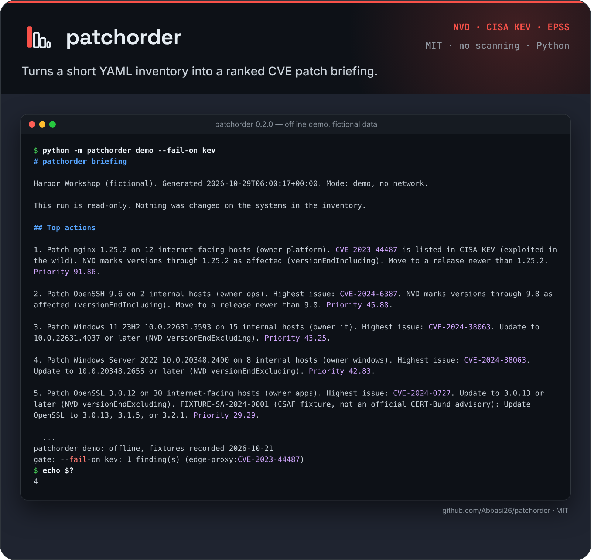
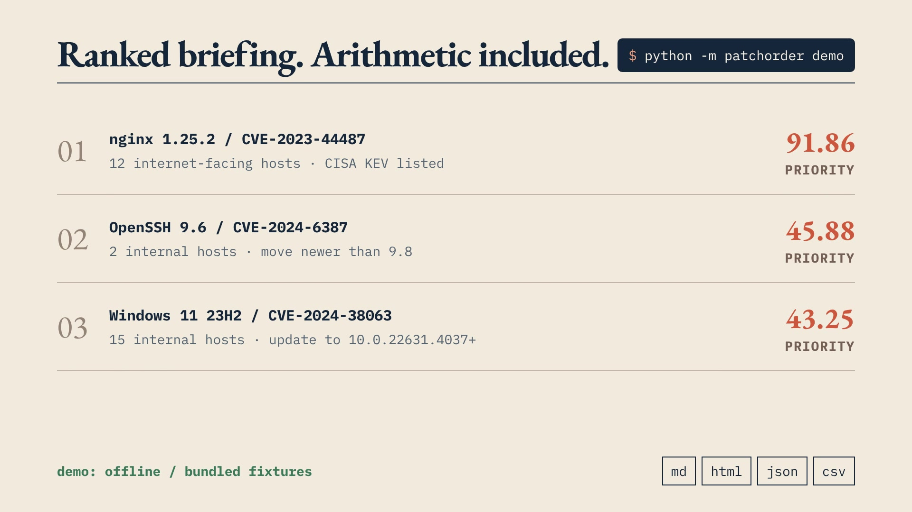

<p align="center">
  <picture>
    <source media="(prefers-color-scheme: dark)" srcset="docs/assets/logo-dark.svg">
    <source media="(prefers-color-scheme: light)" srcset="docs/assets/logo-light.svg">
    
  </picture>
</p>

<p align="center">Turns a short YAML inventory into a ranked CVE patch briefing.</p>

<p align="center">
  
</p>

# patchorder

[](https://github.com/Abbasi26/patchorder/actions/workflows/ci.yml)
[](LICENSE)

Which public CVEs apply to the versions in a local inventory, and what to patch first.

You keep a short YAML file: product, vendor, version, how many hosts, who owns them, and whether they face the internet. patchorder maps each row to CPE candidates, you pin the right one, and it decides affected / not affected / not decided from the published version ranges. The briefing ranks the work. It does not scan a network and it does not install updates.

## Demo video

[](docs/media/brag.mp4)

patchorder answers which public CVEs actually apply to the versions in your local inventory and what to patch first: it maps each YAML row to a CPE, decides affected / not affected / not decided from the published NVD version ranges, and ranks the work with CISA KEV in mind. It does not scan a network or install updates. (Click the image to play the video.)

Music: Sascha Ende ([ende.app](https://ende.app)), licensed under [CC BY 4.0](https://creativecommons.org/licenses/by/4.0/).

## The problem

A vulnerability feed can tell you that something named nginx is having a bad week. It cannot tell you that twelve internet-facing proxies on 1.25.2 are in the vulnerable range and the three you already moved to 1.27.2 are not. [Vulnerability-Lookup](https://vulnerability.circl.lu/) returns every CVE for a vendor and product, on purpose, and leaves the version filter to the client. [OpenCVE](https://www.opencve.io/) subscribes you to a product. [CVE_Prioritizer](https://github.com/TURROKS/CVE_Prioritizer) scores a CVE list you already have. None of them starts from "Windows Server 2022, build 10.0.20348.2400, eight internal hosts."

That last step is this tool. The fictional Harbor Workshop inventory, run offline, opens with:

```text
Patch nginx 1.25.2 on 12 internet-facing hosts (owner platform). CVE-2023-44487 is listed in CISA KEV (exploited in the wild). NVD marks versions through 1.25.2 as affected (versionEndIncluding). Move to a release newer than 1.25.2. Priority 91.86.

Patch OpenSSH 9.6 on 2 internal hosts (owner ops). Highest issue: CVE-2024-6387. NVD marks versions through 9.8 as affected (versionEndIncluding). Move to a release newer than 9.8. Priority 45.88.

Patch Windows 11 23H2 10.0.22631.3593 on 15 internal hosts (owner it). Highest issue: CVE-2024-38063. Update to 10.0.22631.4037 or later (NVD versionEndExcluding). Priority 43.25.
```

The same run says nginx 1.27.2 is outside that range, Windows Server 2022 build 10.0.20348.2655 is the fixed build for CVE-2024-38063, and OpenSSH 9.8p1 sorts after the NVD bound 9.8. A row whose version is the marketing name `2022` is reported as not decided, because comparing the number 2022 with `10.0.20348.2655` would be a false "not affected."

## Quickstart

Python 3.11 or newer.

```bash
python -m pip install -e .
python -m patchorder demo
```

`demo` reads bundled fixtures recorded on 2026-10-21 (Ivanti Connect Secure records on 2026-11-03, CVE-2026-114938 on 2026-11-18) and does not use the network. Add `--format html` or `--format json`. `--output briefing.md` is the explicit way to write a file. With no `--output`, nothing is written.

```bash
python -m patchorder demo --format html --output briefing.html
python -m patchorder demo --llm-preview
```

`--llm-preview` prints the request body and does not send it. The body is CVE identifiers and description text only.

### KEV due dates

Every CISA KEV entry has a `dueDate`. patchorder copies it into each KEV finding and counts the days past it on the run's UTC date (`as_of` in JSON). It reads `cisaActionDue` from the NVD record when no KEV file was loaded. The date shows up in the top actions, the Markdown details, the HTML table, JSON (`kev_due_date`, `kev_overdue_days`), and two new CSV columns at the end. Points do not change. KEV listing already scores 40 points, and a due date set for US federal agencies is not a risk measure for other estates.

The demo has two fictional VPN gateway rows on Ivanti Connect Secure. The CVEs, KEV entries, NVD configurations, and EPSS scores are real recordings:

- `vpn-gateway`, 22.8R2.4, internet-facing: [CVE-2026-104935](https://nvd.nist.gov/vuln/detail/CVE-2026-104935) (KEV added 2026-10-13, due 2026-10-16) and [CVE-2026-111357](https://nvd.nist.gov/vuln/detail/CVE-2026-111357) (KEV added 2026-10-30, due 2026-11-02).
- `vpn-gateway-lab`, 22.8R2.5, internal: only CVE-2026-111357. NVD lists 22.8 r2.5 for that CVE but not for CVE-2026-104935.

Ivanti release strings such as `22.8R2.4` are split into CPE version `22.8` and update `r2.4`, the way NVD writes them.

The demo also has fictional Oracle Java SE rows for [CVE-2026-114938](https://nvd.nist.gov/vuln/detail/CVE-2026-114938) (also called Java4Shell). The id, CVSS, and affected versions are a recording of the official NVD document on 2026-11-18. At that time NVD status was `Received` and the record had no CPE `configurations`, so patchorder matches the Oracle CNA `affected` list: exact supported versions, not a reconstructed range.

- `jdk-app`, Oracle Java SE 17.0.21.0.3, internet-facing: CVE-2026-114938 is affected (exact CNA version).
- `jdk-app-patched`, 17.0.21.1, internet-facing: not affected. Oracle's Java 17 security baseline for the November 2026 Critical Security Patch Update is `17.0.21.1+4`.
- `jdk-11`, 11.0.33.0.3, internal: not affected. The [OpenJDK advisory](https://openjdk.org/groups/vulnerability/advisories/2026-11-17) marks this CVE on the 17, 21, 25, and 27 lines, not 8 or 11. Oracle's CNA list also omits standard Java 8 and 11; it does list the Java 8 Enterprise Performance Pack build `8u511b33-perf`.

Official CVSS 3.1 is 8.1 High (`CVSS:3.1/AV:N/AC:H/PR:N/UI:N/S:U/C:H/I:H/A:H`), scored by Oracle and repeated in the OpenJDK advisory. The CVE was not in CISA KEV catalog version 2026.11.17, so the demo KEV fixture is unchanged. FIRST EPSS had no score for this id at recording time, so the finding has no EPSS points.

Red Hat's bulletin describes OpenJDK 17.0.6 and later as affected on x86-64 CPUs with AVX-512 VBMI, and says standard OpenJDK 8 and 11 are not affected. That broader 17.0.6+ range is not in the NVD/CVE.org structured data yet, so the matcher does not invent it. A version such as 17.0.6 is therefore currently reported as outside the official exact list.

Sources recorded or cited for this example:

- [CVE.org record](https://www.cve.org/CVERecord?id=CVE-2026-114938) (CNA: Oracle)
- [NVD](https://nvd.nist.gov/vuln/detail/CVE-2026-114938)
- [Oracle Critical Security Patch Update, November 2026](https://www.oracle.com/security-alerts/cspunov2026.html)
- [OpenJDK Vulnerability Advisory: 2026/11/17](https://openjdk.org/groups/vulnerability/advisories/2026-11-17)
- [CISA alert, 17 November 2026](https://www.cisa.gov/news-events/alerts/2026/11/17/critical-java-vulnerability-requires-immediate-patching)
- [Red Hat security bulletin RHSB-2026-018](https://access.redhat.com/security/vulnerabilities/RHSB-2026-018)
- Oracle fixed builds: [17.0.21.1](https://www.oracle.com/java/technologies/javase/17-0-21-1-relnotes.html), [21.0.13.1](https://www.oracle.com/java/technologies/javase/21-0-13-1-relnotes.html), [25.0.5.1](https://www.oracle.com/java/technologies/javase/25-0-5-1-relnotes.html), [27.0.1.1](https://www.oracle.com/java/technologies/javase/27-0-1-1-relnotes.html), and [8u513-perf](https://www.oracle.com/java/technologies/javase/8u513-perf-relnotes.html)
- Amazon Corretto changelogs, which address this CVE in [17.0.21.1.2](https://github.com/corretto/corretto-17/blob/develop/CHANGELOG.md) and [27.0.1.1.4](https://github.com/corretto/corretto-27/blob/develop/CHANGELOG.md)
- CISA KEV catalog version 2026.11.17 (not listed), checked at <https://www.cisa.gov/sites/default/files/feeds/known_exploited_vulnerabilities.json>

### Start from a spreadsheet

Most inventories already live in a CMDB export or a spreadsheet. Turn the CSV into inventory YAML, then lint it before the first scan:

```bash
python -m patchorder inventory from-csv hosts.csv --name "My estate" --output inventory.yaml
python -m patchorder inventory check inventory.yaml
```

`from-csv` reads comma, semicolon, or tab separated files and understands common headers (`Software`, `Version`, `Hosts`, `Team`, `Exposed`, `Publisher`). Every version is written quoted, so `1.10` stays `1.10`. Nothing is written without `--output`.

`inventory check` needs no network. It reports rows a scan cannot decide (a Windows marketing name such as `2022` instead of a build, no CPE candidate, an unpinned guess), duplicate rows, zero counts, and lock pins for ids that no longer exist. `--strict` exits 4 on warnings.

### Gate a pipeline or a scheduled job

```bash
python -m patchorder scan -i inventory.yaml --fail-on kev --fail-on priority:70
python -m patchorder scan -i inventory.yaml --state .patchorder/state.json --save-state --fail-on new
python -m patchorder demo --fail-on kev    # exits 4: nginx 1.25.2 is affected by a KEV-listed CVE
python -m patchorder demo --fail-on kev-overdue    # exits 4: KEV due dates on nginx and the VPN gateways have passed
```

The briefing is printed either way. `--fail-on` is repeatable: `kev` (any finding in the loaded KEV catalog), `kev-overdue` (a KEV finding whose due date is before the run's UTC date), `new` (a CVE that was not in `--state`), `internet` (any finding on an internet-facing row), `priority:N` (any finding at or above N points), or `epss:N` (any finding with an EPSS probability at or above N, for example `epss:0.5`). Exit codes: 0 clean, 1 error, 2 usage, 3 offline cache miss, 4 a gate matched.

#### GitHub Actions: offline CSV artifact

The manually triggered [offline scan example](.github/workflows/offline-scan-example.yml) installs patchorder, scans a small fictional inventory without network access, and uploads `offline-scan-findings` as a CSV artifact. Run the same scan locally with:

```bash
mkdir -p .tmp
python -m patchorder scan -i examples/offline-scan/inventory.yaml -l examples/offline-scan/inventory.lock.yaml --offline --no-discover-cpes --pinned-only --cache-dir examples/offline-scan/cache --format csv --output .tmp/offline-findings.csv
```

In GitHub, open **Actions → Offline scan example → Run workflow**. After it finishes, download **offline-scan-findings** from the run's **Artifacts** section. The reduced NVD record was captured on 2026-10-21, the EPSS score on 2026-10-27, and the KEV catalog subset on 2026-10-30; an empty Vulnerability-Lookup response covers that request. These are fixtures, not a current security assessment.

### Findings as CSV

```bash
python -m patchorder demo --format csv --output findings.csv
```

One row per finding, sorted by priority, with KEV, EPSS, CVSS, the fixed-version hint, the CPE, and whether it is new since the last run. Cells that start with `=`, `+`, `-`, or `@` are prefixed with `'` so a spreadsheet does not run them as formulas.

`--columns cve_id,priority,owner,fixed_hint` writes only those columns, in that order, for a ticket import that expects a fixed layout. An unknown or repeated name stops the run with exit 2 and lists the valid names. Without `--columns` the file is unchanged.

## Real usage

Copy `examples/inventory.yaml`. Quote versions. YAML will read an unquoted `1.10` as `1.1`.

```yaml
schema: patchorder.inventory/v1
name: Harbor Workshop (fictional)
assets:
  - id: edge-proxy
    product: nginx
    vendor: F5
    version: "1.25.2"
    count: 12
    owner: platform
    exposure: internet
```

`exposure` is `internet` or `internal`. `count` is a non-negative integer. `owner` is a label for the briefing, not an account.

See the candidates, then pin the CPE you mean. Pinning is a write, so it requires `--write`. The proposed lock file is printed first.

```bash
python -m patchorder resolve -i inventory.yaml --offline --no-discover-cpes
python -m patchorder resolve -i inventory.yaml --write --accept edge-proxy=cpe:2.3:a:f5:nginx
```

In a terminal, `resolve` asks you to pick a number. A lock file looks like this:

```yaml
schema: patchorder.lock/v1
entries:
  edge-proxy:
    cpe: cpe:2.3:a:f5:nginx
    pinned: true
    origin: user
```

The lock stores vendor and product, not the version. The version stays in the inventory and is compared on every run.

```bash
python -m patchorder scan -i inventory.yaml -l inventory.lock.yaml --format md
python -m patchorder scan -i inventory.yaml --state previous.json --save-state .patchorder/state.json
python -m patchorder scan -i inventory.yaml --offline
python -m patchorder scan -i inventory.yaml --csaf ./advisories --pinned-only
```

A live scan calls, per pinned product version:

- NVD CVE API 2.0 `cpeName` (version-aware candidate list)
- Vulnerability-Lookup `cpesearch` for one page (not version-aware; filtered locally)
- the CISA KEV JSON catalog, once
- the FIRST EPSS API, in batches of 100

Responses are cached under `.patchorder/cache`. NVD requests are spaced 6.5 seconds apart (5 requests per 30 seconds without a key). Vulnerability-Lookup requests are spaced 3.5 seconds apart (anonymous limit 20 per minute). Set `NVD_API_KEY` to raise the NVD limit. The key is not written into the cache. `--refresh` ignores cache age. `--offline` uses the cache only and exits 3 when a chosen CPE has no cached vulnerability records.

NVD returns matches oldest-first, at most 2000 per page. `--max-pages` defaults to 2, which covers a product version with up to 4000 matching CVEs (a current Windows Server 2022 build is in that range). Above that, the run keeps the oldest page, the newest page, and every match NVD marks `hasKev`, and the briefing says the middle was not loaded.

CPE discovery (`resolve` and unpinned rows during `scan`) also queries the NVD CPE dictionary. `--no-discover-cpes` keeps the local alias table only. A candidate at or above 0.85 is used and labeled unconfirmed. Below that, the row is not queried. `--pinned-only` queries pins and nothing else.

`--csaf` reads CSAF 2.0 files you already have (one file or a directory of JSON). CERT-Bund publishes those documents at <https://wid.cert-bund.de/.well-known/csaf/>. patchorder does not download that feed: the WID index is tens of megabytes. `--csaf-provider` fetches only the small provider-metadata document and prints the TLP:WHITE feed URLs. A CSAF product id adds priority points only when the document names the installed version. A product name with no version is a mention, not an "affected" decision.

`python -m patchorder sources` lists the endpoints and does not contact them.

### Priority points

Every finding prints its arithmetic. The maximum is 105.

| Signal | Points |
| --- | --- |
| CVE is in the CISA KEV catalog loaded for this run | 40, else 0 |
| EPSS probability | probability × 25, else 0 |
| CVSS base score | score / 10 × 20, else 0 |
| Exposure | 10 internet, 4 internal |
| Host count | min(5, log10(count + 1) / log10(1001) × 5) |
| Loaded CSAF document marks this exact version known_affected | 5, else 0 |

"Not listed" means not listed in the catalog loaded for this run. The demo catalog is one recorded KEV entry out of the published count, so that the offline briefing can show a real exploited-in-the-wild hit. A live scan loads the catalog file it fetched.

### Optional LLM summary

Off unless you pass `--llm`. Any OpenAI-compatible `POST /chat/completions` endpoint works, including a local one.

```bash
export PATCHORDER_LLM_BASE_URL=http://127.0.0.1:11434/v1
export PATCHORDER_LLM_MODEL=llama3.1
export PATCHORDER_LLM_API_KEY=   # optional; do not put the key in the URL
python -m patchorder scan -i inventory.yaml --llm-preview
python -m patchorder scan -i inventory.yaml --llm
```

The JSON body contains CVE identifiers and description text, capped at 20 CVEs and 1200 characters each. It does not contain the inventory. `--llm-preview` prints the body and does not send it. `demo` refuses `--llm` for the same reason: demo mode does not call an endpoint. If the endpoint fails, the local briefing is still produced and the failure is a warning.

### Version matching

The local matcher is the source of the affected / not affected / not decided line. NVD and Vulnerability-Lookup only supply candidate records.

- NVD `versionStartIncluding` / `versionStartExcluding` / `versionEndIncluding` / `versionEndExcluding`
- An exact CPE version, including an update field such as OpenSSH `8.5` update `p1`
- CVE List 5 `versions` blocks (`lessThan`, `lessThanOrEqual`, `status`, `defaultStatus`) when the record has no NVD configuration. Configurations win when both exist
- Windows builds `10.0.<build>.<ubr>` and `6.*`. `10.0.22631.3593` is before `10.0.22631.4037`. The marketing name `2022` is not compared with a build
- OpenSSH `9.8p1` sorts after `9.8`. OpenSSL `1.1.1w` sorts before `1.1.1x`
- A build such as `10.0.22631.3593` on a row that only says "Windows 11" suggests `windows_11_23h2` and does not auto-use it. Build 26100 is offered as both Windows 11 24H2 and Windows Server 2025, unless you set `device_class` to `windows` or `windows-server` (or the product name already says Windows Server)
- Optional inventory field `device_class`: `windows` or `windows-server`. Use it when Intune-managed Windows Server devices should not share CPE candidates with Windows clients. Microsoft Intune can manage eligible Windows Server vNext builds (29621.1000 or later, Desktop Experience) only as a nonproduction Insider preview; see [What's new](https://learn.microsoft.com/en-us/intune/whats-new/) and the [preview guide](https://learn.microsoft.com/en-us/intune/solutions/end-to-end-guides/windows-server-endpoints-get-started). A 29621+ server row does not invent a Windows Server 2028 CPE; pin one after you have checked the dictionary
- A negated CPE node, or an AND configuration that also requires a product this row does not name, is not decided

The alias table is a starter set (nginx, NGINX Plus, OpenSSL, Apache HTTP Server, Tomcat, OpenSSH, PHP, curl, PostgreSQL, MySQL, MariaDB, and a handful of Windows releases). It is not a CPE dictionary. Pin the CPE after you have looked at the candidates.

### Windows Autopatch

patchorder does not deploy updates. If your Windows devices are updated through Windows Autopatch, [docs/windows-autopatch.md](docs/windows-autopatch.md) explains how a finding such as "Update to 10.0.22631.4037 or later" meets the Autopatch approval settings: automatic approval with a 0 to 30 day deferral for monthly security updates, manual approval by default for preview and out-of-band releases, expedite, and pause. Every Autopatch statement there cites a Microsoft source.

## Required permissions

None. The tool reads a YAML file you wrote and, on a live run, makes outbound HTTPS requests to the public endpoints above. It does not need an agent, administrator rights, or credentials on the systems in the inventory.

Writes happen only when you ask:

| Flag | What it writes |
| --- | --- |
| `--output` | the briefing |
| `--write` on `resolve` | the lock file, after printing it |
| `--save-state` | the CVE ids in this run, so the next run can say what is new |
| cache files | HTTP responses under `--cache-dir` (default `.patchorder/cache`) during a live run |

`demo` writes nothing unless you pass `--output`.

## How this differs from existing tools

Aggregation is a solved problem. The gap is the inventory and the version decision.

| Tool | What it already does | What it does not do |
| --- | --- | --- |
| [Vulnerability-Lookup](https://github.com/vulnerability-lookup/vulnerability-lookup) (CIRCL) | Aggregates NVD, CISA KEV, EPSS, CERT-Bund CSAF, and many other sources. Public API. | No inventory file. `cpesearch` matches vendor and product, not the version. No local briefing. |
| [OpenCVE](https://github.com/opencve/opencve) | Subscriptions and daily reports by vendor and product. | No per-version decision. KEV and EPSS are not the point of the product. |
| [CVE_Prioritizer](https://github.com/TURROKS/CVE_Prioritizer) | Scores a CVE list you already hold, using CVSS, EPSS, and KEV. | No inventory and no version match. |
| [cve-search](https://github.com/cve-search/cve-search) | Local CVE database and CPE search. | You operate the database. No briefing that starts from a human inventory. |
| [osv-scanner](https://github.com/google/osv-scanner) | Lockfiles, containers, and SBOMs. | Not a Windows or appliance inventory. |
| [Greenbone Community Edition](https://github.com/greenbone/openvas-scanner) | Network and authenticated scanning. | The opposite of an inventory file. It needs access to the hosts. |

patchorder does not re-host those datasets. A live run asks the public APIs and caches the answers.

## Tests

```bash
python -m pip install -e ".[dev]"
python -m pytest
```

The suite has 103 pytest tests. Pytest blocks sockets. CI runs the same suite on Python 3.11, 3.12, and 3.13, then runs the offline demo with `--fail-on kev` (expected to exit 4) and `inventory check` on the example (`.github/workflows/ci.yml`).

## How to contribute

See [CONTRIBUTING.md](CONTRIBUTING.md).

## Roadmap

See [ROADMAP.md](ROADMAP.md), including issues that are a good first contribution.

## Status

Version 0.2.0, early but usable. Python package `patchorder` (CLI `patchorder`). MIT licensed. Every push runs the test suite in GitHub Actions (`.github/workflows/ci.yml`).

## Install

```sh
pip install .
```

## License

MIT. Copyright 2026 Wasaf Abbasi.

## Kurzfassung (Deutsch)

patchorder ist ein lokales Kommandozeilenwerkzeug. Es beantwortet die Frage, welche öffentlichen Schwachstellen die Versionen in einer Inventardatei wirklich betreffen und was zuerst gepatcht werden sollte.

Die Datei nennt Produkt, Hersteller, Version, Anzahl, Besitzer und ob das System aus dem Internet erreichbar ist. Das Werkzeug schlägt CPE-Kandidaten mit einem Vertrauenswert vor. Die richtige CPE wird in einer Lock-Datei festgehalten. Danach entscheidet ein lokaler Versionsvergleich über betroffen, nicht betroffen oder nicht entscheidbar. Windows-Builds wie `10.0.22631.4037` werden als vier Zahlen verglichen. Ein Marketingname wie `2022` reicht dafür nicht.

Die Priorität setzt sich aus CISA KEV, EPSS, CVSS, Erreichbarkeit, Anzahl und einem versionsscharfen CSAF-Treffer zusammen. Jede Zeile zeigt die Rechnung. Das Briefing kommt als Markdown, HTML, JSON oder CSV und nennt die nächsten Schritte, neue Funde seit dem letzten Lauf, Hinweise auf behobene Versionen und Links zu den Quellen.

Es wird keine eigene Datenbank aufgebaut. Ein Live-Lauf fragt Vulnerability-Lookup, die NVD-API 2.0, den CISA-KEV-Katalog, die EPSS-API und lokal vorliegende CSAF-Dokumente (CERT-Bund veröffentlicht sie unter <https://wid.cert-bund.de/.well-known/csaf/>). Der vollständige WID-Feed wird nicht heruntergeladen. `patchorder demo` läuft ohne Netz auf mitgelieferten Beispieldaten. Es gibt keine Telemetrie. Das Inventar bleibt auf dem Rechner. Ein optionales LLM ist standardmäßig aus und bekommt nur CVE-Texte, nie das Inventar.

Neu in 0.2: `inventory from-csv` macht aus einem CSV-Export ein Inventar, `inventory check` prüft es offline, und `--fail-on kev|new|internet|priority:N` beendet einen CI- oder Nachtlauf mit Exit-Code 4, wenn ein passender Fund auftaucht.

Für Windows-Geräte, die über Windows Autopatch aktualisiert werden, erklärt [docs/windows-autopatch.md](docs/windows-autopatch.md) mit Microsoft-Quellen, wie ein Fund zum Freigabemodell passt: automatische Freigabe mit 0 bis 30 Tagen Verzögerung für monatliche Sicherheitsupdates, manuelle Freigabe als Standard für Vorschau- und Out-of-Band-Updates, Beschleunigen und Pausieren.

Neu: Jeder KEV-Fund nennt das `dueDate` aus dem CISA-Katalog und die Tage seit Ablauf. `--fail-on kev-overdue` schlägt nur bei abgelaufener Frist an. Die Punkte ändern sich dadurch nicht. Die Demo enthält zwei fiktive VPN-Gateways mit Ivanti Connect Secure und den echten KEV-Einträgen CVE-2026-104935 und CVE-2026-111357 sowie fiktive Oracle-Java-SE-Zeilen zu CVE-2026-114938 (Java4Shell; offizieller CVSS-3.1-Wert 8.1, nicht im KEV-Katalog 2026.11.17, Abgleich über die exakten CNA-Versionen, weil die NVD am 18.11.2026 noch keine CPE-Konfigurationen hatte).
